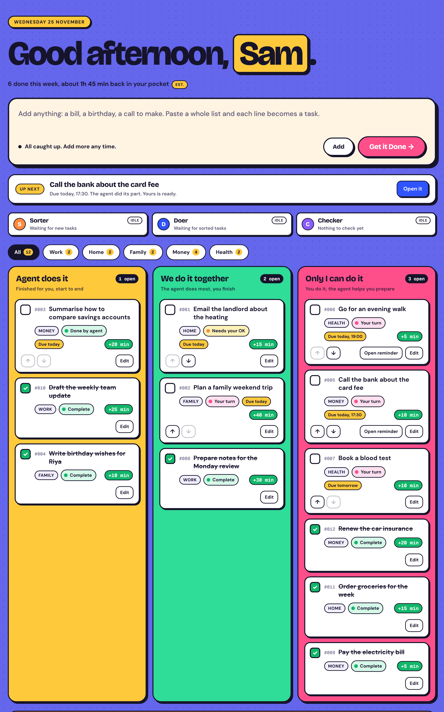
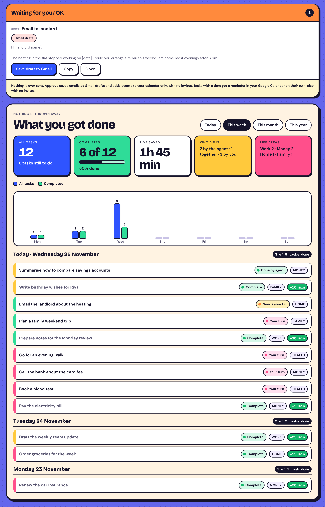

# Get It Done

A personal to-do app that runs as a [Claude](https://claude.ai) artifact. You write down what's on your mind, press **Get it Done**, and three Claude helpers work through the list:

| Helper | What it does |
| --- | --- |
| **Sorter** | Puts each task in a pile, picks a life area (work, home, family, money, health), and reads any date or time you wrote ("by Friday", "at 3pm", "after 8 pm"). |
| **Doer** | Does the work in writing, two tasks at a time: emails, plans, summaries, checklists, call scripts. |
| **Checker** | Reviews the Doer's work and sends it back once if it falls short, then flags it for you if it still isn't right. |

The three piles:

- **Agent does it**: Claude can finish it alone, like a draft or a plan.
- **We do it together**: Claude does most of it and tells you what's left for you.
- **Only I can do it**: things like calls, errands or appointments. Claude helps you prepare with a checklist or script.

**[Try the demo](https://akhilshrwt3.github.io/Get-It-Done/)**: a read-only version with made-up sample tasks, so you can look around before making your own copy.

## A look at the app





*Screenshots use made-up example tasks.*

## Features

- **Paste a whole list.** Each line becomes its own task.
- **Due dates.** Every task is due the day you add it, unless you write a deadline. Overdue tasks get a red tag.
- **Google Calendar reminders.** A task with a time gets its own event, with pop-ups 15 minutes before and at the start. No guests are invited. Each task keeps exactly one event: changing its name, day or time moves that event, and retrying never adds a second one.
- **Waiting for your OK.** Anything meant for another person lands here first. Approving an email only saves it as a **Gmail draft**. Nothing is ever sent.
- **Task cards.** Tick to complete, ↑ ↓ to reorder, Edit (name, date, time, pile, life area) and Open reminder, all on the card.
- **Up next.** Picks the most urgent task: soonest day, then the earliest timed task, then what needs you most. It updates every minute.
- **What you got done.** All tasks vs completed for today, this week, month or year, with a side-by-side column chart and a day-by-day list with each task's status. Unfinished tasks roll forward to today.
- **Saved and private.** Tasks are kept in your own private storage on claude.ai and follow you across devices.

## Make your own copy

Everything runs on **your own Claude account**. The helpers use your Claude plan, Gmail and Calendar use your own connections, and your tasks are stored privately for you. Nobody else, including whoever shared the app with you, can see them.

### What you need

- A claude.ai account where you can create artifacts.
- **Gmail** and **Google Calendar** connected in claude.ai (Settings → Connectors), if you want email drafts and reminders. The rest works without them.

### Steps

1. Download [`index.html`](index.html) from this repository.
2. Start a new chat on claude.ai, attach `index.html`, and send this message:

   > Publish this file as an artifact exactly as it is, without changing the code. Give it these capabilities: `db`, `user` with scopes `["profile"]`, `sample`, and `mcp` with the servers `Gmail` (tool `create_draft`) and `Google Calendar` (tools `create_event`, `update_event` and `list_events`).

3. Open the artifact. The first time the helpers run or a reminder is added, Claude asks you to allow it. Say yes.
4. Add a few tasks and press **Get it Done**.

If you skip `mcp`, everything except Gmail drafts and Calendar reminders still works.

## How it works

`index.html` is one self-contained page: HTML, CSS and JavaScript, plus Google Fonts. It doesn't use a build step or a server. It reaches Claude through the artifact runtime (`window.claude.use(...)`):

| Capability | Used for |
| --- | --- |
| `db` | Saving your tasks in `data/users/<your id>`, which only you can read. |
| `user` | Your first name for the greeting, and your id for private storage. |
| `sample` | The Sorter, Doer and Checker. Each is a prompt to Claude that returns JSON. |
| `mcp` | `Gmail → create_draft` when you approve an email. `Google Calendar → create_event` for reminders and approved events, `update_event` to move that same event when you change a task's name, day or time, and `list_events` to find an event a dropped connection may already have made, so a retry never adds a second one. |

Opened outside claude.ai, for example on GitHub Pages, the page switches to **demo mode**: it shows made-up sample tasks you can open and read, but you can't add, edit or complete anything, and the helpers don't run. Nothing is saved and nothing reaches Gmail or Calendar.

## Tests

The date, Up next and history logic lives in one block of `index.html` (`<script id="gid-logic">`), separate from the page code, so it can be tested without a browser. With Node 20 or newer:

```
npm test
```

The tests read that block straight out of `index.html`, so the app is still a single file you can publish as it is.

## Safety

- The helpers can only write. The prompts tell them never to claim they sent, booked, paid or called anything, and the Checker fails any answer that does.
- Emails are only ever saved as drafts. You send them yourself from Gmail.
- Calendar events are created with notifications turned off and no guests.
